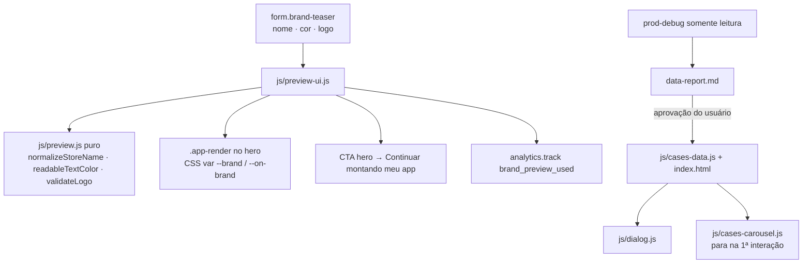

# F3 · Mágica e cases · Design

**Spec**: `.specs/features/lp-magia-cases/spec.md`
**Context**: `.specs/features/lp-magia-cases/context.md`
**Status**: Approved (segue AD-001..007)

---

## Architecture Overview

O hero ganha um formulário (nome, cor, logo) e um "app desenhado" em HTML/CSS dentro do mesmo enquadramento do celular. Até a primeira interação aparece a foto real da Hiven; depois, o app desenhado. Tudo roda no navegador; nada sai do aparelho. Os cases recebem números coletados do banco de produção (somente leitura) e aprovados pelo usuário.

---

## Code Reuse Analysis

| Component | Location | How to Use |
| --------- | -------- | ---------- |
| Enquadramento do celular do hero | `index.html` `.hero-device` | `.app-render` fica no mesmo container, sobre a foto |
| Notificação de push desenhada | `.push-message` (`styles.css`) | Mesmo visual para o push do app desenhado |
| `analytics.track` | F2 | Evento `brand_preview_used` |
| `dialog.js` + `details` map | F1 (migrado de `app.js`) | Conteúdo dos cases vem de `js/cases-data.js` |
| `waLink('case', nome)` | F2 | Link "Quero um resultado assim" |
| `motion.isPaused()` | F1 | Carrossel respeita a pausa |
| Mockup do onboarding do admin | monorepo `admin/src/pages/onboarding/mockup/*` | Só referência visual |

---

## Components

### js/preview.js (puro)
- `normalizeStoreName(raw) → string`: trim, colapsa espaços, corta em 24, vazio → "Sua Loja".
- `readableTextColor(hex) → '#ffffff' | '#0f1a33'`: escolhe a cor com contraste ≥ 4,5:1 (luminância relativa WCAG).
- `validateLogo({type, size}) → {ok} | {ok: false, message}`: tipos `image/png|jpeg|webp|svg+xml`, ≤ 2MB.

### js/preview-ui.js
Liga o formulário (input com debounce 0, `requestAnimationFrame`), troca `.hero-device` para o modo `is-custom`, escreve o nome via `textContent`, aplica `--brand`/`--on-brand`, gerencia a URL de objeto do logo (revoga a anterior), troca o texto do CTA e emite o evento uma vez.

### .app-render (HTML + `styles/components.css`)
Status bar, cabeçalho com logo/nome, banner na cor da marca, grade 2×2 de produtos neutros, barra de abas com a aba ativa na cor, e um push "NOME · agora — Seu carrinho sentiu saudade". `aria-hidden="true"` com `data-illustration`; o formulário é a parte acessível, e uma região `aria-live` anuncia "Prévia atualizada: app da NOME".

### js/cases-data.js
Fonte única dos cases (nome, categoria, métrica do card, métricas extras, período, textos), consumida por `dialog.js`. O HTML dos cards continua estático (sem JS, mostra os números).

### Coleta (T1)
Skill `prod-debug` do monorepo, papel somente leitura. Saída: `data-report.md` (métrica, período, data da coleta, observações), sem consultas, credenciais ou IDs (AD-003). Parada obrigatória para aprovação do usuário.

---

## Error Handling Strategy

| Error Scenario | Handling | User Impact |
| -------------- | -------- | ----------- |
| Logo inválido | Mensagem; mantém o logo anterior | Sabe o que enviar |
| Logo SVG com script | Exibido via `` (scripts de SVG não rodam em `img`) | Nenhum |
| Banco de produção indisponível / sessão SSO expirada | Coleta para; usuário faz `aws sso login`; números atuais permanecem | Nenhum no site |
| Sem JS | Formulário com `hidden` até o JS iniciar; foto real visível | Hero estático |

---

## Risks & Concerns

| Concern | Location | Impact | Mitigation |
| ------- | -------- | ------ | ---------- |
| Expor dados de clientes | cases | Quebra de confiança | Só percentuais/razões e aprovação do usuário (DATA-3) |
| A métrica original dos cases pode não ser reproduzível no banco | cases | Número sem lastro | Relatório sinaliza; case mantém a métrica original com período |
| Hero mais alto no mobile com o formulário | hero | CTA desce | Formulário compacto (uma linha de input + linha de cores); teste MOB-1 da F1 continua valendo |

---

## Tech Decisions

| Decision | Choice | Rationale |
| -------- | ------ | --------- |
| Seletor "outra cor" | `<input type="color">` nativo | Acessível e sem dependência |
| Paleta de 6 cores | #155DFC, #0F1A33, #E11D48, #16A34A, #F59E0B, #7C3AED | Cobre os nichos dos clientes; contraste resolvido por `readableTextColor` |
