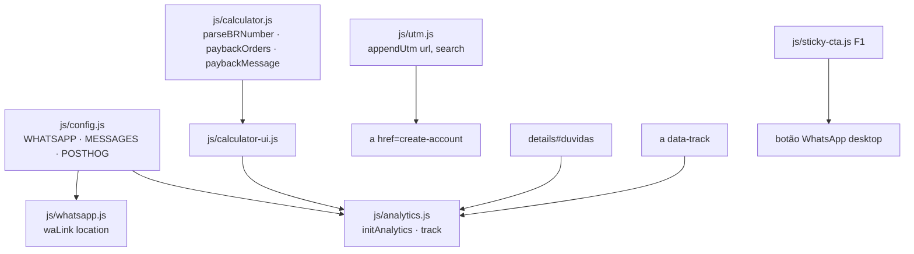

# F2 · Oferta e contato · Design

**Spec**: `.specs/features/lp-oferta-contato/spec.md`
**Context**: `.specs/features/lp-oferta-contato/context.md`
**Status**: Approved (segue AD-001..007)

---

## Architecture Overview

Os links de cadastro e WhatsApp são escritos completos no HTML (funcionam sem JS). `js/config.js` guarda número, mensagens e chave PostHog; um teste garante que o HTML bate com a configuração. JS só acrescenta comportamento: UTM, eventos, calculadora.

---

## Code Reuse Analysis

| Component | Location | How to Use |
| --------- | -------- | ---------- |
| `sticky-cta.js` | F1 | Mesmo observador para a barra mobile (com WhatsApp) e o botão flutuante desktop |
| Classes `.button`, `.link`, `.signup-cta` | `styles.css` | Novos CTAs usam as mesmas classes |
| `details/summary` do FAQ | `index.html` | Mantido; só muda o conteúdo |
| `dialog.js` | F1 | F3 adiciona o link de WhatsApp do case |

---

## Components

### js/config.js (estende F1)
`WHATSAPP_NUMBER = '555194553299'`, `WHATSAPP_DISPLAY = '(51) 9455-3299'`, `SUPPORT_EMAIL`, `MESSAGES = {hero, pricing, closing, floating, case: name => …}`, `POSTHOG_KEY = ''`, `POSTHOG_API_HOST = 'https://burrito.korza.com.br'`, `POSTHOG_UI_HOST = 'https://us.posthog.com'`, `PLAN_PRICE = 399`.

### js/whatsapp.js
`waLink(location, caseName?) → string` (pura, testada como unidade).

### js/calculator.js (pura)
- `parseBRNumber(str) → number | NaN` (aceita "179,90", "1.234,5", "180").
- `paybackOrders(ticket, marginPct) → {ok: true, orders} | {ok: false, field, message}`.
- `paybackMessage(orders) → string` (singular/plural).

### js/calculator-ui.js
Liga os inputs, atualiza a região `aria-live`, emite `calculator_used` uma vez.

### js/analytics.js
- `initAnalytics(config)`: se a chave estiver vazia, não faz nada. Senão, injeta o snippet oficial do PostHog com `api_host`/`ui_host` da config; falha de carregamento é engolida.
- `track(event, props)`: no-op seguro quando desativado ou o script falhou.
- Delegação de clique em `[data-track]` → `cta_click {location, destination}`.

### js/utm.js (pura + init)
`appendUtm(href, search) → href` (só `utm_*`, primeira ocorrência, sem duplicar); `initUtm()` reescreve os links de cadastro.

### HTML
Card de preço reescrito com calculadora; FAQ com 8 perguntas; seção comparativo (`table`) antes do preço; rodapé com WhatsApp e e-mail; links "Falar com especialista" em hero, preço, FAQ e fechamento.

---

## Error Handling Strategy

| Error Scenario | Handling | User Impact |
| -------------- | -------- | ----------- |
| Script PostHog bloqueado | `onerror` marca analytics como indisponível; `track` vira no-op | Nenhum |
| Entrada inválida na calculadora | Mensagem do campo, sem N | Instrução clara |
| Sem JS | Resultado padrão "8 pedidos" no HTML; links funcionam | Nenhum |

---

## Risks & Concerns

| Concern | Location | Impact | Mitigation |
| ------- | -------- | ------ | ---------- |
| Número de WhatsApp repetido no HTML | `index.html` | Divergência | Teste compara todo `wa.me` com `config.js` |
| Região do PostHog incerta (us/eu) | `config.js` | Painel errado | Constante única; confirmar ao receber a chave |
| Sem consentimento de cookies | — | LGPD quando o PostHog ligar | Registrado como fora de escopo; PostHog desligado até a chave existir |

---

## Tech Decisions

| Decision | Choice | Rationale |
| -------- | ------ | --------- |
| Snippet PostHog | Snippet oficial de carregamento assíncrono, injetado só com chave | Sem custo quando desligado |
| Fonte da verdade dos links | HTML estático validado por teste | Funciona sem JS |
